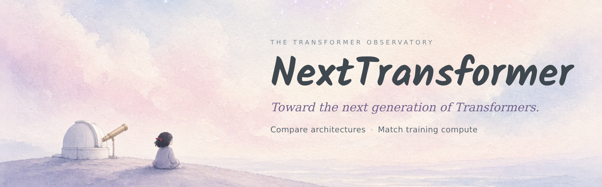
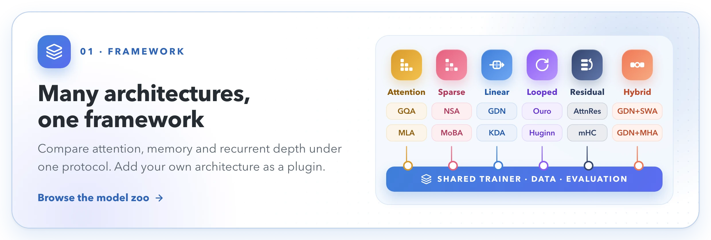
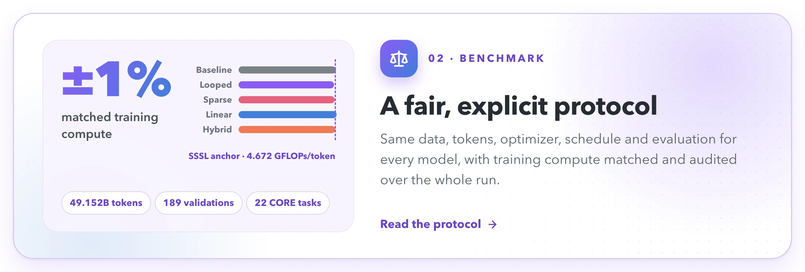
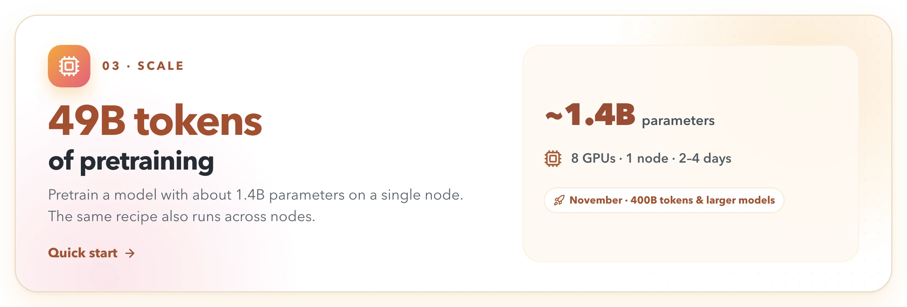
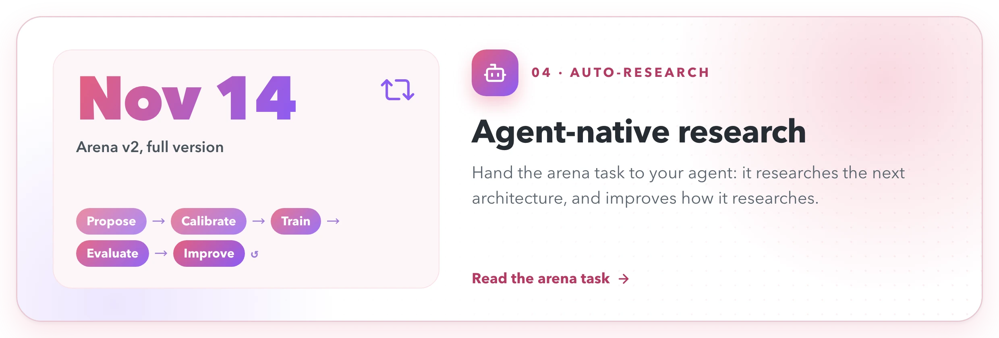
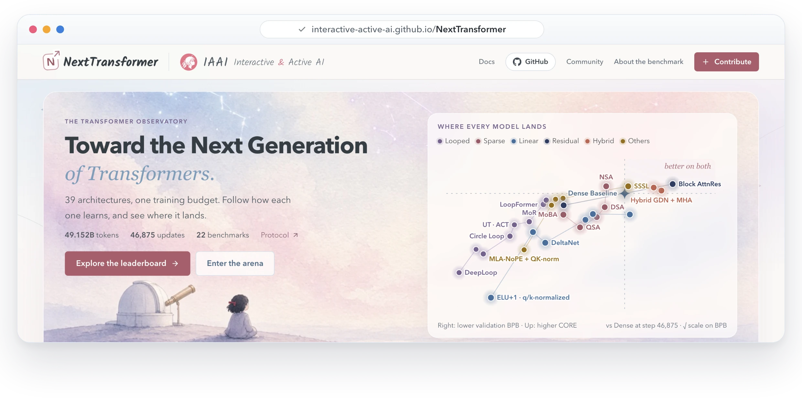
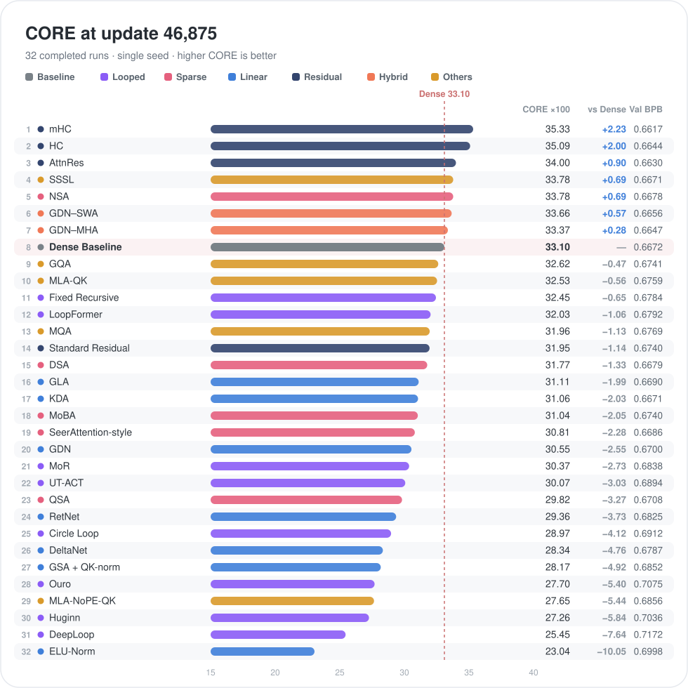
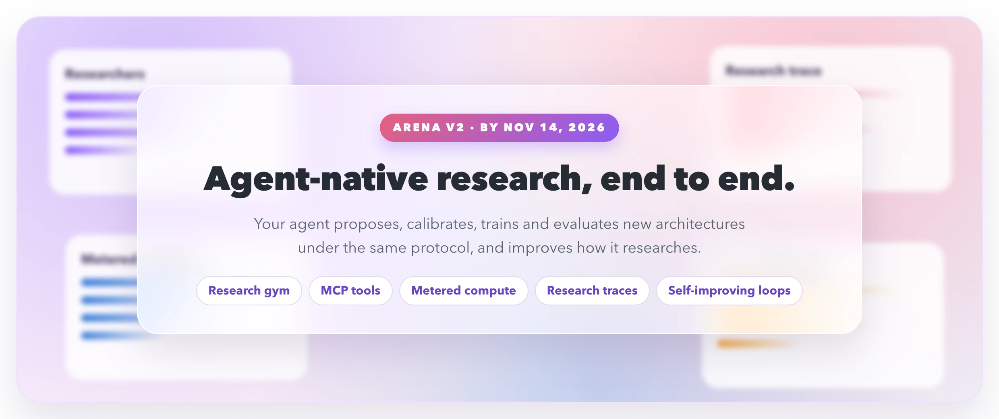

<div align="center">

<a href="https://interactive-active-ai.github.io/NextTransformer/"></a>

<h3>The comprehensive, cutting-edge open-source framework, benchmark<br>and auto-research platform for next-generation Transformers</h3>

<p>
<a href="https://interactive-active-ai.github.io/NextTransformer/"></a>
<a href="https://interactive-active-ai.github.io/NextTransformer/docs/"></a>
<a href="#quick-start"></a>
</p>

<p>
<a href="https://interactive-active-ai.github.io/NextTransformer/#leaderboard"></a>
<a href="LICENSE"></a>


<a href="https://interactive-active-ai.github.io/NextTransformer/docs/community/#wechat"></a>
<a href="https://github.com/Interactive-Active-AI/NextTransformer/discussions"></a>
</p>

<b>English</b> · <a href="README.zh-CN.md">简体中文</a>

</div>

<br>

**When the training budget is fixed, how should a language model spend its computation?** NextTransformer trains
recurrent depth, sparse and linear attention, residual-stream variants and hybrids on the same data, for the same
49.152B tokens, at the same theoretical training FLOPs per token, and evaluates them at the same checkpoints. Every
result is an audited, file-backed record, and AI agents can research new architectures under the very same rules.

## News

-  **2026-10-31** · NextTransformer is now open source: 31 finished runs, 36 model cards, the full protocol, the documentation and the observatory.
-  **By 2026-11-14** · **Arena v2**, with full support for autonomous agent research.
-  **November 2026** · Training recipes for **400B tokens and larger models**.

## Highlights

<a href="https://interactive-active-ai.github.io/NextTransformer/docs/methods/zoo/"></a>

<a href="https://interactive-active-ai.github.io/NextTransformer/docs/protocol/overview/"></a>

<a href="https://interactive-active-ai.github.io/NextTransformer/docs/getting-started/quick-start/"></a>

<a href="https://interactive-active-ai.github.io/NextTransformer/docs/arena/task/"></a>

## The observatory

<a href="https://interactive-active-ai.github.io/NextTransformer/"></a>

Learning curves of every run, a replayable leaderboard, all 22 CORE tasks, architecture diagrams and model cards, in
your browser.

## Results

<!-- generated:leaderboard -->
<a href="https://interactive-active-ai.github.io/NextTransformer/#leaderboard"></a>

[Full leaderboard](https://interactive-active-ai.github.io/NextTransformer/docs/results/leaderboard/) · [Training replay](https://interactive-active-ai.github.io/NextTransformer/#leaderboard)
<!-- /generated:leaderboard -->

## Quick start

**1. Install** (Linux, NVIDIA GPUs, [uv](https://docs.astral.sh/uv/)):

```bash
git clone https://github.com/Interactive-Active-AI/NextTransformer.git && cd NextTransformer
uv sync --frozen --extra gpu --extra upstream && source .venv/bin/activate
uv pip install --no-deps --require-hashes -r requirements/linear.txt   # linear-attention kernels
```

**2. Prepare the data** (ClimbMix at a pinned revision, about 600 GB, plus the tokenizer and CORE bundle):

```bash
cp site.native.example.json site.local.json        # set data_dir and resources
hf download karpathy/climbmix-400b-shuffle --repo-type dataset \
  --revision 915333b4f8b8684f39aeaafea600fea6f43fb703 --local-dir /path/to/climbmix-400b-shuffle
source launch/env.sh --site-config site.local.json
python -m nexttransformer.prepare --site-config site.local.json
```

**3. Train on one node with 8 GPUs:**

```bash
launch/train.sh --config configs/baseline/dense_full.json --site-config site.local.json \
  --output runs/dense_full --micro-batch 8 --formal --resume auto
```

**4. Multi-node training (2 nodes × 8 GPUs)**

Install `uv pip install accelerate==1.15.0` in the training environment. Submit one distributed job with the following per-node entry point. Map the platform's node rank, main node address and port to the three variables shown:

```bash
export FLA_DISABLE_BACKEND_DISPATCH=1   # registered FLA Triton path (linear and hybrid methods)
accelerate launch --config_file launch/accelerate.yaml \
  --machine_rank "$NODE_RANK" --main_process_ip "$MASTER_ADDR" --main_process_port "$MASTER_PORT" \
  -m nexttransformer.train --config configs/linear/gdn.json --site-config site.local.json \
  --output runs/gdn --micro-batch 16 --formal
```

On Slurm, submit `sbatch launch/slurm.sbatch` for the same example. The batch script gets the launch parameters from the allocation. [Cluster setup and other node counts](https://interactive-active-ai.github.io/NextTransformer/docs/getting-started/quick-start/#multi-node)

Evaluation runs on schedule during training. The [quick start guide](https://interactive-active-ai.github.io/NextTransformer/docs/getting-started/quick-start/)
covers smoke tests, evaluation, auditing and exporting a result.

## Model zoo

<details open>
<summary><b>Browse architectures by family</b></summary>

<!-- generated:model-zoo -->
| Family | Models |
|---|---|
|  | Dense Baseline |
|  | Standard Residual · AttnRes · HC\* · mHC |
|  | UT-ACT · Fixed Recursive · Huginn · Ouro · DeepLoop · MoR · LoopFormer · Circle Loop |
|  | DSA · QSA · NSA · SeerAttention-style · MoBA |
|  | DeltaNet · GSA + QK-norm · GLA · KDA · RetNet · ELU-Norm · GDN |
|  | GDN–MHA · GDN–SWA · DeltaNet–MHA\* · KDA–MLA-NoPE\* · GDN–QSA\* · MoBA–MHA\* |
|  | SSSL · MQA · GQA · MLA-QK · MLA-NoPE-QK |
<!-- /generated:model-zoo -->

\* Results coming soon. Papers, adaptations and configurations are in the [model zoo](https://interactive-active-ai.github.io/NextTransformer/docs/methods/zoo/).

</details>

## The protocol at a glance

| | |
|---|---|
| **Data** | ClimbMix at a pinned revision · one 32,768-token tokenizer · 2,048-token context · one global sample order |
| **Budget** | 49.152B input tokens · 46,875 updates of 1,048,576 tokens · seed 42 |
| **Compute** | 4.672 GFLOPs per input token (forward, backward, auxiliary and optimizer work); ±1% at admission, ±2% over the run |
| **Evaluation** | Validation BPB at 189 points · full CORE-22 at six checkpoints · an independent final BPB |
| **Baseline** | Dense: full causal attention in every layer, trained under the same budget |

Parameters, memory and speed are outcomes, not controls. The [protocol](https://interactive-active-ai.github.io/NextTransformer/docs/protocol/overview/)
explains every rule and the [compute accounting](https://interactive-active-ai.github.io/NextTransformer/docs/protocol/compute/)
what is counted.

## Add your method

1. **Write a plugin**: a folder `nexttransformer/methods/<name>/` with a `method.json` and a few hooks. No shared file changes.
2. **Calibrate** it to the shared budget: `python -m nexttransformer.protocol.calibrate --methods <name> ...`
3. **Open a pull request.** Once admitted, train it with `--formal` and submit the result in a second pull request.

Start with the [plugin guide](https://interactive-active-ai.github.io/NextTransformer/docs/guides/plugins/) and
[CONTRIBUTING.md](CONTRIBUTING.md).

## Auto-research arena

<a href="https://interactive-active-ai.github.io/NextTransformer/docs/arena/overview/"></a>

> [!NOTE]
> **The arena is in active development.** Arena v2, with full support for autonomous agent research (a research gym
> with MCP tools, metered compute, research traces and self-improving research loops), ships by **November 14, 2026**.

Any LLM, with or without a research framework, can already enter an architecture today: it is trained under the same
protocol, ranked on the same leaderboard, and disclosed with how it was found. See the
[arena](https://interactive-active-ai.github.io/NextTransformer/docs/arena/overview/).

## Roadmap

- **By November 14, 2026:** Arena v2 and agent-native research.
- **November 2026:** recipes for 400B tokens and larger models.
- **Upcoming results:** Hyper-Connections, mHC, four more hybrids and three controls.
- **Planned:** checkpoints and the tokenizer on the Hugging Face Hub.

More on the [roadmap](https://interactive-active-ai.github.io/NextTransformer/docs/roadmap/).

## Community

- [GitHub Discussions](https://github.com/Interactive-Active-AI/NextTransformer/discussions) for questions and ideas
- [WeChat group](https://interactive-active-ai.github.io/NextTransformer/docs/community/#wechat)

Contributions are welcome; please read [CONTRIBUTING.md](CONTRIBUTING.md) and the [code of conduct](CODE_OF_CONDUCT.md).

## Citation

```bibtex
@software{nexttransformer2026,
  title   = {NextTransformer: An Open Framework and Fair Benchmark for Next-Generation Transformer Architectures},
  author  = {{NextTransformer contributors}},
  year    = {2026},
  version = {0.1.0},
  url     = {https://github.com/Interactive-Active-AI/NextTransformer}
}
```

## Acknowledgments

NextTransformer builds on [nanochat](https://github.com/karpathy/nanochat) and ideas from
[modded-nanogpt](https://github.com/KellerJordan/modded-nanogpt), uses
[flash-linear-attention](https://github.com/fla-org/flash-linear-attention) kernels, and trains on
[ClimbMix](https://huggingface.co/datasets/karpathy/climbmix-400b-shuffle). We thank the authors of every method in the
zoo. Released under the [MIT License](LICENSE); see [third-party notices](THIRD_PARTY_NOTICES.md).
