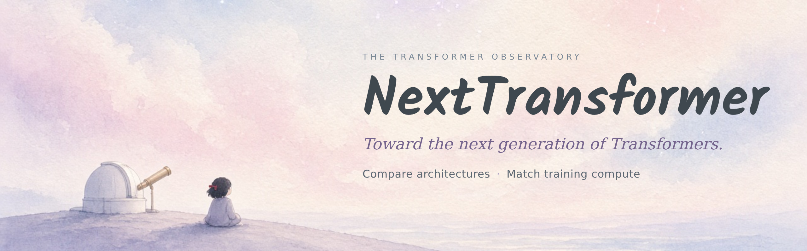
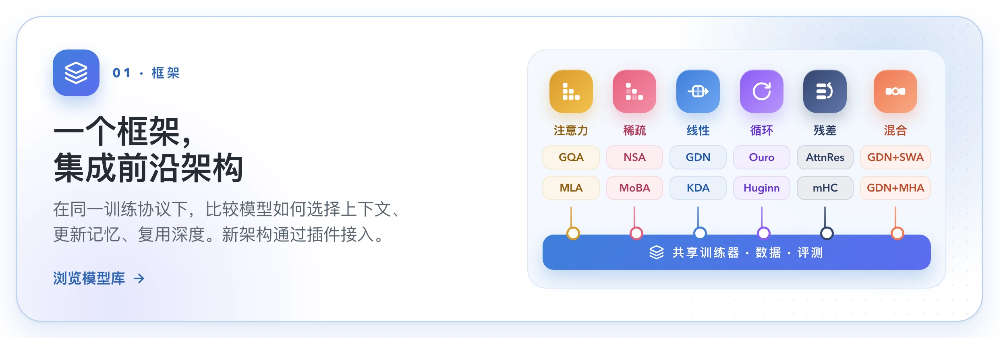
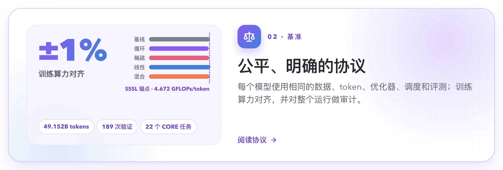
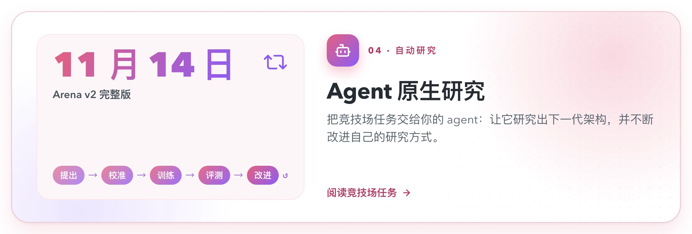
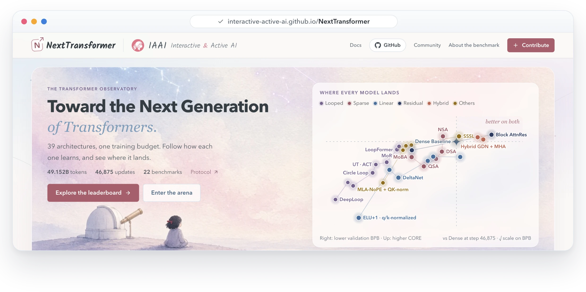
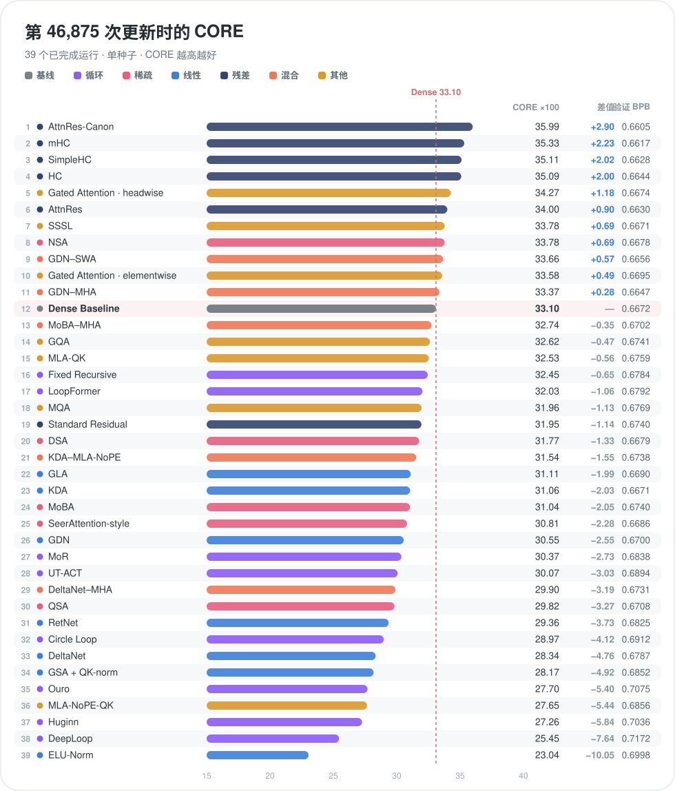

<div align="center">

<a href="https://interactive-active-ai.github.io/NextTransformer/"></a>

<h3>面向下一代 Transformer 的全面、综合、最前沿的<br>开源框架、比较平台与自动研究平台</h3>

<p>
<a href="https://interactive-active-ai.github.io/NextTransformer/"></a>
<a href="https://interactive-active-ai.github.io/NextTransformer/docs/zh-cn/"></a>
<a href="#快速开始"></a>
</p>

<p>
<a href="https://interactive-active-ai.github.io/NextTransformer/#leaderboard"></a>
<a href="https://huggingface.co/NextTransformer"></a>
</p>

<p>
<a href="https://discord.gg/k2XPXW6Jz">Discord</a> · <a href="https://interactive-active-ai.github.io/NextTransformer/docs/zh-cn/community/#wechat">微信</a> · <a href="https://github.com/Interactive-Active-AI/NextTransformer/discussions">讨论区</a> · <a href="CITATION.cff">引用</a><br>
<sub>Python 3.10–3.13 · PyTorch 2.9.1 · <a href="LICENSE">MIT 许可证</a></sub>
</p>

<a href="README.md">English</a> · <b>简体中文</b>

</div>

<br>

**在训练预算固定时，语言模型应该如何分配它的计算？** NextTransformer 让循环深度、稀疏与线性注意力、残差流变体和混合架构在相同的数据上、
用相同的 49.152B tokens、相同的每 token 理论训练 FLOPs 进行训练，并在相同的检查点上评测。每个结果都是经过审计、以文件形式保存的记录；
AI agent 也可以在完全相同的规则下研究新架构。

## 新闻

-  **2026-11-05** · **[Scaling 提案](https://github.com/Interactive-Active-AI/NextTransformer/discussions/22)**：在 ClimbMix 上以 **4K 序列**训练 **200B／400B tokens 的 Dense 和 MoE 模型**，征集数据、模型配置和评测建议。
-  **2026-11-04** · 社区项目 **[NextTransformer-V](https://github.com/Enderfga/NextTransformer-V)**（作者 [@Enderfga](https://github.com/Enderfga)）：多模态版本，在同一套算力对齐的约定下，用图文交错的 token 训练 NextTransformer 的每种方法。第一项研究经过预注册，探讨混合架构从哪里得到图像的二维布局。
-  **2026-10-31** · NextTransformer 正式开源：31 个完成的运行、36 张模型卡片、完整的协议、文档和观测站。
-  **2026-11-14 前** · **Arena v2**：全面支持 agent 自主研究。

## 亮点

<a href="https://interactive-active-ai.github.io/NextTransformer/docs/zh-cn/methods/zoo/"></a>

<a href="https://interactive-active-ai.github.io/NextTransformer/docs/zh-cn/protocol/overview/"></a>

<a href="https://interactive-active-ai.github.io/NextTransformer/docs/zh-cn/getting-started/quick-start/"></a>

<a href="https://interactive-active-ai.github.io/NextTransformer/docs/zh-cn/arena/task/"></a>

## 观测站

<a href="https://interactive-active-ai.github.io/NextTransformer/"></a>

每个运行的学习曲线、可回放的排行榜、全部 22 个 CORE 任务、架构图和模型卡片，都可以在浏览器中查看。

## 结果

<!-- generated:leaderboard -->
<a href="https://interactive-active-ai.github.io/NextTransformer/#leaderboard"></a>

[完整排行榜](https://interactive-active-ai.github.io/NextTransformer/docs/zh-cn/results/leaderboard/) · [训练回放](https://interactive-active-ai.github.io/NextTransformer/#leaderboard)
<!-- /generated:leaderboard -->

## 快速开始

**1. 安装**（Linux、NVIDIA GPU、[uv](https://docs.astral.sh/uv/)）：

```bash
git clone https://github.com/Interactive-Active-AI/NextTransformer.git && cd NextTransformer
uv sync --frozen --extra gpu --extra upstream && source .venv/bin/activate
uv pip install --no-deps --require-hashes -r requirements/linear.txt   # 线性注意力 kernel
```

**2. 准备数据**（锁定版本的 ClimbMix，约 600 GB，以及分词器和 CORE 评测包）：

```bash
cp site.native.example.json site.local.json        # 设置 runtime_dir、resources 和 data_dir
hf download karpathy/climbmix-400b-shuffle --repo-type dataset \
  --revision 915333b4f8b8684f39aeaafea600fea6f43fb703 --local-dir /path/to/climbmix-400b-shuffle
source launch/env.sh --site-config site.local.json
python -m nexttransformer.prepare --site-config site.local.json
```

**3. 单机 8 卡训练：**

```bash
launch/train.sh --config configs/baseline/dense_full.json --site-config site.local.json \
  --output runs/dense_full --micro-batch 8 --formal --resume auto
```

**4. 多机训练（2 节点 × 8 卡）**

在训练环境中安装 `uv pip install accelerate==1.15.0`。创建一个每节点执行一次入口命令的分布式作业，在作业配置中把平台提供的节点编号、主节点地址和端口映射到下面三个变量：

```bash
export FLA_DISABLE_BACKEND_DISPATCH=1   # 线性与混合方法走注册的 FLA Triton 路径
accelerate launch --config_file launch/accelerate.yaml \
  --machine_rank "$NODE_RANK" --main_process_ip "$MASTER_ADDR" --main_process_port "$MASTER_PORT" \
  -m nexttransformer.train --config configs/linear/gdn.json --site-config site.local.json \
  --output runs/gdn --micro-batch 16 --formal
```

在 Slurm 上，直接提交 `sbatch launch/slurm.sbatch` 即可运行同一示例，脚本会从资源分配中取得这些参数。[集群配置与其他节点数](https://interactive-active-ai.github.io/NextTransformer/docs/zh-cn/getting-started/quick-start/#multi-node)

评测会在训练过程中按计划自动运行。[快速开始指南](https://interactive-active-ai.github.io/NextTransformer/docs/zh-cn/getting-started/quick-start/)介绍了冒烟测试、评测、审计和导出结果。

## 模型库

模型权重的发布入口是 [NextTransformer 的 Hugging Face 主页](https://huggingface.co/NextTransformer)。在 **Models** 栏可以查看当前可下载的权重。[排行榜](https://interactive-active-ai.github.io/NextTransformer/#leaderboard) 收录的是已完成评测的模型，其中也包括尚未发布权重的模型。

贡献者已发布的权重：[AttnRes-Canon（49B 对比实验）](https://huggingface.co/GY2233/nextt-arena-attnres-full-canon-abcd) · [Dense（200B tokens 扩展实验）](https://huggingface.co/Enderfga/nextt-scaling-dense-200b-4k)。

<details open>
<summary><b>按模型族浏览架构</b></summary>

<!-- generated:model-zoo -->
| 模型族 | 模型 |
|---|---|
|  | Dense Baseline |
|  | Standard Residual · AttnRes · HC · mHC · AttnRes-Canon |
|  | UT-ACT · Fixed Recursive · Huginn · Ouro · DeepLoop · MoR · LoopFormer · Circle Loop |
|  | DSA · QSA · NSA · SeerAttention-style · MoBA |
|  | DeltaNet · GSA + QK-norm · GLA · KDA · RetNet · ELU-Norm · GDN |
|  | GDN–MHA · GDN–SWA · DeltaNet–MHA · KDA–MLA-NoPE · GDN–QSA\* · MoBA–MHA |
|  | SSSL · MQA · GQA · MLA-QK · MLA-NoPE-QK · Gated Attention · elementwise · Gated Attention · headwise |
<!-- /generated:model-zoo -->

\* 结果即将发布。论文、调整和配置见[模型库](https://interactive-active-ai.github.io/NextTransformer/docs/zh-cn/methods/zoo/)。

</details>

## 协议速览

| | |
|---|---|
| **数据** | 锁定版本的 ClimbMix · 一个 32,768-token 分词器 · 2,048-token 上下文 · 一个全局样本顺序 |
| **预算** | 49.152B 输入 token · 46,875 次更新，每次 1,048,576 tokens · seed 42 |
| **算力** | 每输入 token 4.672 GFLOPs（前向、反向、辅助和优化器计算）；准入时 ±1%，整个运行 ±2% |
| **评测** | 189 个点的验证 BPB · 6 个检查点上的完整 CORE-22 · 独立的最终 BPB |
| **基线** | Dense：每层都是完整因果注意力，在同一预算下训练 |

参数量、显存和速度是结果，而不是控制项。[协议](https://interactive-active-ai.github.io/NextTransformer/docs/zh-cn/protocol/overview/)解释了每条规则，[算力核算](https://interactive-active-ai.github.io/NextTransformer/docs/zh-cn/protocol/compute/)说明了哪些计算被计入。

## 添加你的方法

新方法和竞技场参赛项目采用相同的提交流程。

1. 先[开提案 issue](https://github.com/Interactive-Active-AI/NextTransformer/issues/new/choose)，讨论方法和实验计划。
2. 在自己的 fork 上实现插件，按统一算力预算完成校准，并用 `--formal` 完成正式训练。
3. 审计并导出结果后，再向上游 `main` 提交**一个 PR**，同时包含方法实现和正式结果，并关联提案 issue。

从[插件指南](https://interactive-active-ai.github.io/NextTransformer/docs/zh-cn/guides/plugins/)和 [CONTRIBUTING.md](CONTRIBUTING.md) 开始。

## 自动研究竞技场

<a href="https://interactive-active-ai.github.io/NextTransformer/docs/zh-cn/arena/overview/"></a>

> [!NOTE]
> **竞技场正在积极开发中。** 全面支持 agent 自主研究的 Arena v2（带 MCP 工具的研究 gym、算力计量、研究轨迹和自我改进的研究循环）将于 **2026 年 11 月 14 日**前上线。

现在任何 LLM（无论是否借助研究框架）就已经可以提交架构参赛：它在相同的协议下训练、在同一个排行榜上排名，并披露它是如何被发现的。见[竞技场](https://interactive-active-ai.github.io/NextTransformer/docs/zh-cn/arena/overview/)。

## 基于 NextTransformer 的项目

扩展 NextTransformer 的社区项目。

<table>
<tr>
<td width="50%" valign="top">
<a href="https://github.com/Enderfga/NextTransformer-V"></a>
<h3><a href="https://github.com/Enderfga/NextTransformer-V">NextTransformer-V</a></h3>
<p> 作者 <a href="https://github.com/Enderfga">@Enderfga</a></p>
<p>冻结的 SigLIP2 图像 token 与文本交错排进 8,192 长度的上下文，NextTransformer 的每种方法都不用改动就能直接训练，训练算力对齐到 1% 以内。第一项研究经过预注册，探讨混合架构从哪里读取图像的二维布局。</p>
</td>
<td width="50%" valign="top">
<a href="https://github.com/DAGroup-PKU/ResearchBoost-Agent"></a>
<h3><a href="https://github.com/DAGroup-PKU/ResearchBoost-Agent">ResearchBoost-Agent</a></h3>
<p> 作者 <a href="https://github.com/AI4AI-for-Anything">AI4AI for Anything</a>，贡献者 <a href="https://github.com/henry-y">@henry-y</a></p>
<p>自动分析、优化并验证 AI 训练代码的 agent。它为 NextTransformer 贡献了可选的 <code>--speedups</code>（<a href="https://github.com/Interactive-Active-AI/NextTransformer/pull/26">#26</a>），把所有方法共用的外壳融合成更少的 kernel。其中 <code>exact</code> 模式与默认路径逐位一致，可用于正式运行，在单机 8 卡上把 <code>dense_full</code> 的训练提速 1.38 倍。</p>
</td>
</tr>
<tr>
<td colspan="2" align="center">
<h3>你的项目</h3>
<p>做了基于 NextTransformer 代码或协议的项目？欢迎在 <a href="https://github.com/Interactive-Active-AI/NextTransformer/discussions/categories/show-and-tell">Show and tell</a> 分享，或提交 pull request 加一张卡片，并附一张宽幅横幅图。</p>
<sub>收录的项目需公开，并在 README 中注明基于 NextTransformer。</sub>
</td>
</tr>
</table>

## 路线图

- **2026 年 11 月 14 日前：** Arena v2 和 agent 原生研究。
- **2026 年 11 月：** 在 ClimbMix 上采用 **4K 序列**，以 **200B 和 400B tokens** 两档预算训练 **Dense 和 MoE** 模型。
- **征集建议：** 数据混合、模型配置和 CORE 之外的评测，见 [scaling 提案](https://github.com/Interactive-Active-AI/NextTransformer/discussions/22)。
- **即将发布的结果：** GDN + QSA 和 MoBA + MHA 混合架构。
- **计划中：** 在 Hugging Face Hub 上发布检查点和分词器。

详见[路线图](https://interactive-active-ai.github.io/NextTransformer/docs/zh-cn/roadmap/)。

## 社区

- [Discord](https://discord.gg/k2XPXW6Jz)：加入 #general 交流（永久邀请链接）
- [微信交流群](https://interactive-active-ai.github.io/NextTransformer/docs/zh-cn/community/#wechat)
- [GitHub Discussions](https://github.com/Interactive-Active-AI/NextTransformer/discussions)：提问与想法

欢迎参与贡献；请阅读 [CONTRIBUTING.md](CONTRIBUTING.md) 和[行为准则](CODE_OF_CONDUCT.md)。社区项目见[基于 NextTransformer 的项目](#基于-nexttransformer-的项目)。

## 引用

```bibtex
@software{nexttransformer2026,
  title   = {NextTransformer: An Open Framework and Fair Benchmark for Next-Generation Transformer Architectures},
  author  = {{NextTransformer contributors}},
  year    = {2026},
  version = {0.1.0},
  url     = {https://github.com/Interactive-Active-AI/NextTransformer}
}
```

## 致谢

NextTransformer 基于 [nanochat](https://github.com/karpathy/nanochat)，借鉴了 [modded-nanogpt](https://github.com/KellerJordan/modded-nanogpt) 的思路，使用
[flash-linear-attention](https://github.com/fla-org/flash-linear-attention) 的 kernel，并在 [ClimbMix](https://huggingface.co/datasets/karpathy/climbmix-400b-shuffle)
上训练。感谢模型库中每个方法的作者。本项目以 [MIT 许可证](LICENSE)发布；见[第三方声明](THIRD_PARTY_NOTICES.md)。
