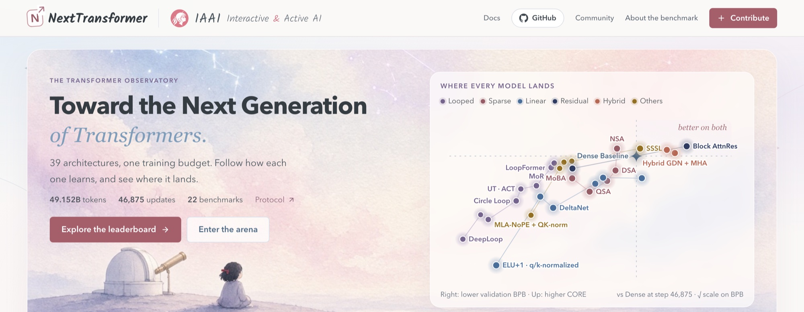

<div align="center">

<a href="https://interactive-active-ai.github.io/NextTransformer/"></a>

<h3>面向下一代 Transformer 架构的开源框架与公平基准</h3>

<p>
<a href="https://interactive-active-ai.github.io/NextTransformer/docs/zh-cn/"></a>
<a href="https://interactive-active-ai.github.io/NextTransformer/#leaderboard"></a>
<a href="LICENSE"></a>


<br>
<a href="https://interactive-active-ai.github.io/NextTransformer/docs/zh-cn/community/#wechat"></a>
<a href="https://github.com/Interactive-Active-AI/NextTransformer/discussions"></a>
</p>

<b>
<a href="https://interactive-active-ai.github.io/NextTransformer/">观测站</a> ·
<a href="https://interactive-active-ai.github.io/NextTransformer/docs/zh-cn/">文档</a> ·
<a href="#快速开始">快速开始</a> ·
<a href="https://interactive-active-ai.github.io/NextTransformer/docs/zh-cn/protocol/overview/">协议</a> ·
<a href="#自动研究竞技场">竞技场</a> ·
<a href="#社区">社区</a> ·
<a href="README.md">English</a>
</b>

</div>

<br>

**在训练预算固定时，语言模型应该如何分配它的计算？** NextTransformer 让循环深度、稀疏与线性注意力、残差流变体和 hybrid
在相同的数据上、用相同的 49.152B tokens、相同的每 token 理论训练 FLOPs 进行训练，并在相同的检查点上评测。每个结果都是经过审计、以文件形式保存的记录，
可以在[观测站](https://interactive-active-ai.github.io/NextTransformer/)中查看。

## 新闻

- **2026-11-01** · NextTransformer **v0.1.0** 开源：29 个完成的运行、39 张模型卡片、完整的协议、文档和观测站。
- **2026-11-14 前** · **Arena v2**：全面支持 agent 自主研究，提供研究 gym 和算力计量。
- **2026 年 11 月** · **400B tokens 和更大模型**的训练配方。

## 亮点

<table>
<tr>
<td width="50%" valign="top">

**一个框架，集成前沿架构**<br>
39 个模型，覆盖完整注意力、残差连接、线性与稀疏注意力、循环计算和 hybrid，全部在基于 nanochat 的同一套代码中。新方法只需[一个插件目录](https://interactive-active-ai.github.io/NextTransformer/docs/zh-cn/guides/plugins/)。

</td>
<td width="50%" valign="top">

**公平、明确的协议**<br>
每个模型使用相同的数据、token、优化器、调度和评测。训练算力由算子级账本对齐到 ±1% 以内，并对整个运行做审计。[阅读协议](https://interactive-active-ai.github.io/NextTransformer/docs/zh-cn/protocol/overview/)。

</td>
</tr>
<tr>
<td width="50%" valign="top">

**单机完成 1B 级预训练**<br>
在一台 8 卡机器上，2–4 天即可用 49B tokens 训练约 1.4B 参数的模型，也可以扩展到 16 或 32 卡。400B tokens 和更大模型的配方将于 11 月补齐。

</td>
<td width="50%" valign="top">

**Agent 原生研究**<br>
把[竞技场任务](https://interactive-active-ai.github.io/NextTransformer/docs/zh-cn/arena/task/)交给你的 agent，让它研究出下一代架构，并不断改进自己的研究方式。完整版本将于 2026 年 11 月 14 日前上线。

</td>
</tr>
</table>

## 观测站

<a href="https://interactive-active-ai.github.io/NextTransformer/"></a>

每个运行的学习曲线、可回放的排行榜、全部 22 个 CORE 任务、架构图和模型卡片。第 46,875 次更新时领先的运行，与完整注意力的 Dense Baseline 对比：

<!-- generated:leaderboard -->
| 模型 | 模型族 | 验证 BPB ↓ | Δ BPB | CORE ↑ | Δ CORE |
|---|---|---:|---:|---:|---:|
| **Dense Baseline** | baseline | 0.6672 | — | 33.10 | — |
| Block Attention Residuals · AttnRes | residual | 0.6630 | −0.0042 | 34.00 | +0.90 |
| SSSL¹ | others | 0.6671 | ±0.0000 | 33.78 | +0.69 |
| Native Sparse Attention · NSA | sparse | 0.6678 | +0.0006 | 33.78 | +0.69 |
| Hybrid GDN + SWA | hybrid | 0.6656 | −0.0015 | 33.66 | +0.57 |
| Hybrid GDN + MHA | hybrid | 0.6647 | −0.0025 | 33.37 | +0.28 |
| Grouped-Query Attention · GQA | others | 0.6741 | +0.0069 | 32.62 | −0.47 |
| Multi-head Latent Attention · MLA + QK-norm | others | 0.6759 | +0.0087 | 32.53 | −0.56 |

单种子运行；¹ 使用历史算力核算。全部 29 个运行及其说明见[排行榜](https://interactive-active-ai.github.io/NextTransformer/docs/zh-cn/results/leaderboard/)。
<!-- /generated:leaderboard -->

## 快速开始

**1. 安装**（Linux、NVIDIA GPU、[uv](https://docs.astral.sh/uv/)）：

```bash
git clone https://github.com/Interactive-Active-AI/NextTransformer.git && cd NextTransformer
uv sync --frozen --extra gpu --extra upstream && source .venv/bin/activate
uv pip install --no-deps --require-hashes -r requirements/linear.txt   # 线性注意力 kernel
```

**2. 准备数据**（锁定版本的 ClimbMix，约 600 GB，以及分词器和 CORE 评测包）：

```bash
cp site.native.example.json site.local.json        # 设置 data_dir 和 resources
hf download karpathy/climbmix-400b-shuffle --repo-type dataset \
  --revision 915333b4f8b8684f39aeaafea600fea6f43fb703 --local-dir /path/to/climbmix-400b-shuffle
source launch/env.sh --site-config site.local.json
python -m nexttransformer.prepare --site-config site.local.json
```

**3. 单机 8 卡训练：**

```bash
launch/train.sh --config configs/baseline/dense_full.json --site-config site.local.json \
  --output runs/dense_full --micro-batch 8 --formal --resume auto
```

**4. 或者多机训练**，在每台机器上运行同一条命令，或使用 SLURM：

```bash
NNODES=2 NODE_RANK=0 MASTER_ADDR=node0 launch/train.sh --config configs/linear/gdn.json \
  --site-config site.local.json --output runs/gdn --micro-batch 16 --formal --resume auto   # 节点 1 上 NODE_RANK=1

sbatch --nodes=4 launch/slurm.sbatch --config configs/linear/gdn.json --site-config site.local.json \
  --output runs/gdn --micro-batch 16 --formal --resume auto --max-wall-hours 23.5
```

评测会在训练过程中按计划自动运行。[快速开始指南](https://interactive-active-ai.github.io/NextTransformer/docs/zh-cn/getting-started/quick-start/)介绍了冒烟测试、评测、审计和导出结果。

## 模型库

<details>
<summary><b>七个模型族，共 39 个模型</b>（点击展开）</summary>

| 模型族 | 模型 |
|---|---|
| Baseline | Dense（完整因果注意力） |
| Residual | Standard Residual · Block Attention Residuals · Hyper-Connections\* · mHC\* |
| Looped | Universal Transformer · ACT · Fixed Recursive · Huginn · Ouro · DeepLoop · Mixture-of-Recursions · LoopFormer · Circle Loop |
| Sparse | DeepSeek Sparse Attention · Qwen Sparse Attention · Native Sparse Attention · SeerAttention-style · MoBA |
| Linear | DeltaNet · Gated DeltaNet · Gated Linear Attention · Kimi Delta Attention · RetNet · Linear Transformer (ELU+1)† · ELU+1 with q/k-norm · KDA without VE\* |
| Hybrid | GDN + MHA · GDN + SWA · DeltaNet + MHA\* · KDA + MLA-NoPE\* · GDN + QSA\* · MoBA + MHA\* |
| Others | SSSL · MQA · GQA · MLA + QK-norm · MLA-NoPE + QK-norm · MLA-NoPE\* · MHA without VE\* |

\* 结果即将发布。† 在协议下未能稳定训练，由 q/k 归一化版本替代。论文、调整和配置见[模型库](https://interactive-active-ai.github.io/NextTransformer/docs/zh-cn/methods/zoo/)。

</details>

## 协议速览

| | |
|---|---|
| **数据** | 锁定版本的 ClimbMix · 一个 32,768-token 分词器 · 2,048-token 上下文 · 一个全局样本顺序 |
| **预算** | 49.152B 输入 token · 46,875 次更新，每次 1,048,576 tokens · seed 42 |
| **算力** | 每输入 token 4.672 GFLOPs（前向、反向、辅助和优化器计算）；准入时 ±1%，整个运行 ±2% |
| **评测** | 189 个点的验证 BPB · 6 个检查点上的完整 CORE-22 · 独立的最终 BPB |
| **基线** | Dense：每层都是完整因果注意力，在同一预算下训练 |

参数量、显存和速度是结果，而不是控制项。[协议](https://interactive-active-ai.github.io/NextTransformer/docs/zh-cn/protocol/overview/)解释了每条规则，[算力核算](https://interactive-active-ai.github.io/NextTransformer/docs/zh-cn/protocol/compute/)说明了哪些计算被计入。

## 添加你的方法

1. **编写插件**：一个 `nexttransformer/methods/<name>/` 目录，包含 `method.json` 和几个 hook。无需修改共享文件。
2. **校准**到共同预算：`python -m nexttransformer.protocol.calibrate --methods <name> ...`
3. **提交 pull request。** 准入之后用 `--formal` 训练，并在第二个 pull request 中提交结果。

从[插件指南](https://interactive-active-ai.github.io/NextTransformer/docs/zh-cn/guides/plugins/)和 [CONTRIBUTING.md](CONTRIBUTING.md) 开始。

## 自动研究竞技场

> [!NOTE]
> **竞技场正在积极开发中。** 全面支持 agent 自主研究的 Arena v2（带 MCP 工具的研究 gym、算力计量、研究轨迹和自我改进的研究循环）将于 **2026 年 11 月 14 日**前上线。

现在任何 LLM（无论是否借助研究框架）就已经可以提交架构参赛：它在相同的协议下训练、在同一个排行榜上排名，并披露它是如何被发现的。见[竞技场](https://interactive-active-ai.github.io/NextTransformer/docs/zh-cn/arena/overview/)。

## 路线图

- **2026 年 11 月 14 日前：** Arena v2 和 agent 原生研究。
- **2026 年 11 月：** 400B tokens 和更大模型的配方。
- **即将发布的结果：** Hyper-Connections、mHC、另外四个 hybrid 和三个对照实验。
- **计划中：** 在 Hugging Face Hub 上发布检查点和分词器。

详见[路线图](https://interactive-active-ai.github.io/NextTransformer/docs/zh-cn/roadmap/)。

## 社区

- [微信交流群](https://interactive-active-ai.github.io/NextTransformer/docs/zh-cn/community/#wechat)（二维码即将上线）
- [GitHub Discussions](https://github.com/Interactive-Active-AI/NextTransformer/discussions)：提问与想法

欢迎参与贡献；请阅读 [CONTRIBUTING.md](CONTRIBUTING.md) 和[行为准则](CODE_OF_CONDUCT.md)。

## 引用

```bibtex
@software{nexttransformer2026,
  title   = {NextTransformer: An Open Framework and Fair Benchmark for Next-Generation Transformer Architectures},
  author  = {{NextTransformer contributors}},
  year    = {2026},
  version = {0.1.0},
  url     = {https://github.com/Interactive-Active-AI/NextTransformer}
}
```

## 致谢

NextTransformer 基于 [nanochat](https://github.com/karpathy/nanochat)，借鉴了 [modded-nanogpt](https://github.com/KellerJordan/modded-nanogpt) 的思路，使用
[flash-linear-attention](https://github.com/fla-org/flash-linear-attention) 的 kernel，并在 [ClimbMix](https://huggingface.co/datasets/karpathy/climbmix-400b-shuffle)
上训练。感谢模型库中每个方法的作者。本项目以 [MIT 许可证](LICENSE)发布；见[第三方声明](THIRD_PARTY_NOTICES.md)。
