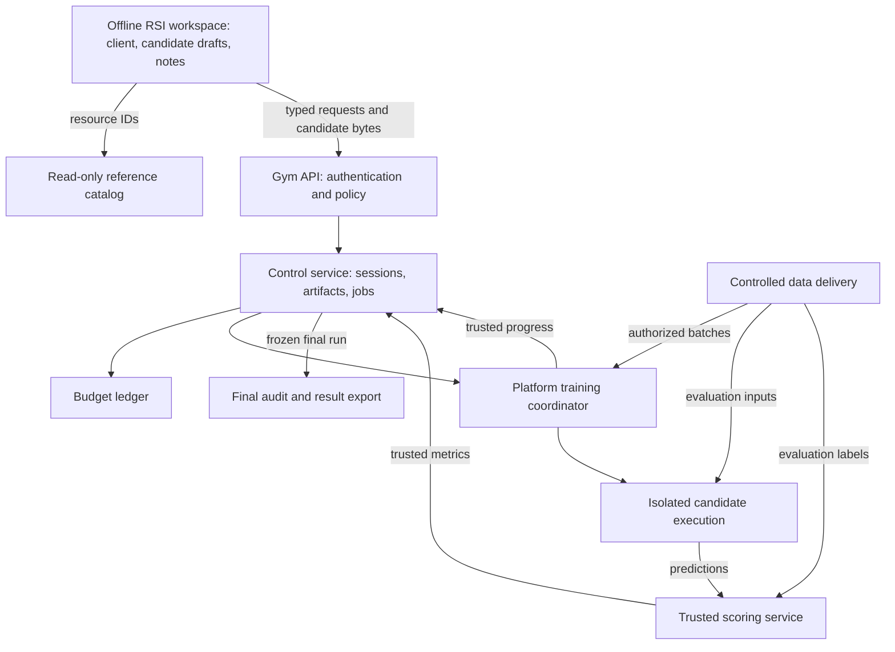

# NextTransformer Gym: design principles and interface specification

Status: design proposal for review; no gym service is implemented by this document.
Source behavior was inspected at NextTransformer commit `41b6016`. This proposal
does not amend the frozen NextTransformer protocol or Arena v1 rules, and its
policies are not adopted upstream by the existence of this document.

## 1. Purpose and deliverable

Build an offline research environment in which an RSI system designs language-model
architectures, learns from controlled experiments, and submits **one final architecture**.
The gym automatically executes and scores that architecture. Final presentation uses
the existing leaderboard's BPB, CORE, compute and provenance fields.

The participant receives a **Gym API/SDK**, a versioned architecture component
contract, read-only reference material and a candidate workspace. It does **not**
receive an executable checkout of the platform repository, a training installation,
a dataset directory or permission to modify the evaluator.

The platform retains NextTransformer, environments, data, execution resources,
training/evaluation code, accounting and publication. Participants submit architecture
source and configuration, never repository patches, training commands, pretrained
weights or authoritative scores.

Success means that different RSI systems can use the same interface, starting
materials and resource limits to conduct research, while the platform determines
what actually ran, how much it consumed, and how the final model performed.
This evaluates architecture research ability in this task family; it is not by itself
a claim about general recursive self-improvement.

## 2. Design principles and their consequences

### 2.1 Separate research decisions from experimental authority

The researcher decides what architecture to try, how much research to allocate,
which results merit continuation and which candidate to submit. The platform owns
execution, measurement and policy enforcement.

This preserves meaningful search freedom without allowing the researcher to improve
its apparent score by changing the optimizer, data, evaluator or accounting. A useful
API exposes experimental decisions, not arbitrary access to the machine.

| Researcher owns | Platform owns |
| --- | --- |
| Hypothesis, plugin implementation and architecture options | Supported plugin contract and component runtime |
| Candidate lineage and selection | Immutable candidate identity and provenance |
| Experiment length, continuation and early stopping | Fixed profile semantics, training and data order |
| Allocation across concurrent experiments | Atomic reservations and resource scheduling |
| One final architecture choice | Fresh final training, evaluation, audit and result export |

### 2.2 Expose a capability, not a repository

Understanding source is valuable; modifying infrastructure is unnecessary. Serve
selected architecture implementations, interfaces and examples as read-only resources.
Accept candidate packages in a separate namespace. Never accept a patch against the
platform tree, an arbitrary command, a filesystem overlay or a participant installer.

An importable client SDK must remain a client: importing it in the researcher process
must not load platform internals or grant in-process access to the trainer.
Architecture components are provided separately inside the candidate runtime, through
a documented versioned contract. API and SDK names below are proposals, not existing
packages.

### 2.3 Keep exploration flexible and final comparison controlled

Research architectures may differ in FLOPs/token. The researcher sees this difference
and pays for it. Requiring every exploratory idea to match the final anchor before
any experiment would unnecessarily constrain search.

Final official admission is different: the selected architecture/configuration must
meet the fixed protocol, including the cost constraint. Calibration can produce a
new architecture configuration during research, but final submission must explicitly
select that configuration. The platform never silently changes the submitted design.

A better score from a more expensive or longer experiment is useful feedback, not
automatically evidence of a matched improvement. Return the relevant cost, tokens,
steps, data and profile with every observation.

### 2.4 Budget the entire search, not just its winner

A system that tries many failed ideas has consumed research resources even if it
submits only one successful architecture. Training, dev evaluation, dynamic checks,
profiling, failures and cancellation all contribute executed model computation.

Use theoretical experiment FLOPs as the v1 hard research account. This matches the
project's architectural-compute emphasis across hardware, while throughput, memory,
GPU-hours and elapsed time remain useful separate observations. Equal FLOPs do not
imply equal latency or monetary cost. Agent inference cost is explicitly deferred.

### 2.5 Feedback should support diagnosis, not only ranking

A scalar score does not explain whether a candidate is invalid, unstable, too costly,
undertrained or promising. Return structured diagnostics, training curves, dev BPB,
resource measurements and accounting. Let RSI systems decide how to use them.

Do not leak formal evaluation through logs, downloadable artifacts or job events while
research remains open. Published baseline results are explicitly public starting
context, not new feedback on a participant's current candidate.

### 2.6 Immutable artifacts make decisions reproducible

Freeze the source, configuration, profile and environment that determine an experiment.
Give source candidates, executions and checkpoints distinct identities. A code change
creates a new candidate, and a changed architecture/configuration starts from scratch.

State belongs to the gym rather than an agent conversation. Controller restarts and
network retries must not reset budgets, duplicate jobs or lose experiment lineage.

### 2.7 Offline isolation and accounting are requirements, not trust assumptions

Treat all candidate Python as untrusted. Read-only files, hashes, AST checks and
containers each help, but none alone proves safe execution or complete accounting.
A participant cannot gain permissions by naming a path, claiming a cost or supplying
a result file. Unsupported computational paths fail closed.

The permitted executable language/runtime must be narrow enough to enforce these
requirements. General unrestricted Python plus a tracing pass is not an acceptable
substitute. Selecting and validating that runtime is an implementation gate, not a
capability this document claims already exists.

## 3. Proposed v1 scope and decisions

| Area | V1 decision |
| --- | --- |
| Architecture freedom | Existing plugin-compatible composition and local invention; no arbitrary replacement of the shared model shell |
| Research connectivity | Offline workspace and workers; only a restricted platform inference broker for researcher LLM calls |
| Starting conditions | Same approved references, component versions, templates and baseline records per comparison cohort |
| Participant output | One final source architecture plus declared configuration; no research weights |
| Execution | All candidate execution goes through the gym, including CPU debug computation |
| Search policy | RSI chooses bounded training lengths, stopping, continuation and final selection |
| Concurrency | Allowed, with a configured limit and one shared session account |
| Research budget | Finite, explicit cumulative experiment FLOPs cap; missing cap blocks execution |
| Unaccountable computation | Rejected before real dispatch; not run for free as a diagnostic |
| Resume | Same immutable architecture/configuration and compatible complete checkpoint only |
| Research feedback | Training loss and dev BPB plus cost, diagnostics and resource observations |
| Final scoring | One frozen candidate, from scratch, common separate final allocation |
| Display | Official leaderboard-style result; no required new composite or research-efficiency score |
| Failure accounting | Executed work remains charged, including failed and cancelled attempts |

The numeric research cap, machine allocation, worker limits and sandbox implementation
are deployment settings still to specify. No numeric default or training authorization
is implied by this document.

## 4. What is reusable from NextTransformer

Paths below are relative to the platform checkout, not paths exposed to participants.

| Existing capability | Source | Reuse and limitation |
| --- | --- | --- |
| Model construction/loading | `nexttransformer/models/__init__.py` | Common model API and checkpoint reconstruction |
| Architecture families | `nexttransformer/models/` | Reference components for attention, recurrence, residuals and hybrids |
| Plugin declarations and hooks | `nexttransformer/models/plugins.py` | Metadata discovery and mixer/FFN/block/model hooks; not a security boundary |
| Model shell | `nexttransformer/models/lm.py`, `models/config.py` | Initial compatibility target; model hook remains a `ReferenceLM` subclass |
| Operator accounting and calibration | `nexttransformer/protocol/` | Cost convention and admission; not a session-wide resource ledger |
| Training and restoration | `nexttransformer/train.py`, `runtime/checkpoint.py` | Scientific behavior to preserve and test against |
| Data and evaluation | `runtime/data.py`, `evaluation/formal.py` | Tokenization, packing, BPB and CORE semantics; no ready dev-only runner |
| Final audit and export | `audit_run.py`, `export_run.py` | Final completeness checks and result format |
| Result presentation | `results/`, `website/` | File-backed official-style leaderboard |

The formal shell fixes width 1536, 12 heads, vocabulary 32768 and sequence length 2048;
shared initialization expects particular attention/FFN projections. Advertising a
`model` hook must not imply arbitrary `nn.Module` freedom.

The current `BestFitStream` only accepts `train` and `val`. The current trainer also
performs validation in smoke mode. Wrapping `--research` or `--smoke-steps` directly
would not create the dev-only research backend required here.

The existing trainer and loss API load model code in-process. That is scientific
infrastructure, not an isolation boundary. A safe adapter must preserve the intended
numerics and pass parity checks; do not claim the frozen executable can simply run
unchanged with arbitrary hostile plugins and remain secure. Formal compatibility
must be demonstrated before exporting formal-compatible results.

## 5. System layout and trust boundaries



- **Research workspace:** contains drafts and client tools, not a runtime checkout.
  Code editing/search tools are permitted. Unrestricted shell execution would defeat
  the all-computation-through-gym rule even without a GPU; the research harness must
  mediate tool execution. An uncontrolled external agent host can use the API but
  cannot claim the same enforced-budget offline cohort.
- **Control plane:** owns authentication, authorization, artifact validation, job
  transitions and ledger writes. It never imports participant modules.
- **Candidate worker:** has only its frozen package, approved component runtime,
  operation-specific inputs and a private output area. No network egress, credentials,
  host socket, writable platform code or other session storage. Training coordination
  and privileged scoring are not participant-controlled Python globals.
- **Data/scoring plane:** controls batch delivery and derives metrics. Participants
  cannot read arbitrary dataset files or declare their own evaluation labels.
- **Inference broker:** allows only the declared researcher-model API, without tools,
  browsing, arbitrary URLs or environment secrets. Model identity and access policy
  are recorded even while inference cost accounting remains TODO.

Container/VM choice, device isolation and the supported execution subset require
validation. The architecture describes required boundaries, not a promise that a
particular container configuration is sufficient.

## 6. Participant-facing resources and candidate package

### 6.1 Read-only catalog

Expose versioned resource IDs for:

- component signatures, tensor shapes, hooks, supported operations and restrictions;
- selected architecture source and explanatory documentation;
- complete small templates and valid configuration examples;
- approved baseline records with their original protocol/cost labels;
- research profiles, final-admission requirements and accounting conventions.

`read_reference(resource_id)` cannot read an arbitrary path or URL. Responses are
bounded and identical for participants in the same cohort. Copying reference code
into a candidate changes only that candidate, never the platform original.

### 6.2 Submission format

Proposed package:

```text
candidate/
  proposal.json
  architecture.json
  plugin/<method>/
    method.json
    __init__.py
    <optional local Python modules>
```

Example metadata; this is a proposed envelope, not an implemented schema:

```json
{
  "schema_version": "gym.candidate.v1",
  "sdk_version": "reference_plugin_v1",
  "method": "example_mixer",
  "parent_ids": [],
  "hypothesis": "Replace selected mixers while retaining the shared shell."
}
```

`architecture.json` contains architecture choices only. Allowed fields and ranges
come from the selected contract; reject optimizer overrides, data paths, seeds,
evaluation options, commands and environment settings. `method.json` retains the
existing declaration structure where supported. The platform resolves hooks itself;
participants do not provide a launcher or arbitrary import target.

Only bounded text/source files and declared metadata are accepted in v1. Reject
absolute paths, traversal, symlinks, duplicate/ambiguous paths, binary payloads,
package-name collisions, oversized submissions and attempts to shadow SDK/runtime
modules. Do not accept pretrained state, participant executables or dependency installs.
These controls do not prove absence of memorized information embedded in source;
keep payload limits, provenance and adversarial validation explicit.

The server computes the canonical content hash. A candidate identity binds source,
architecture configuration and contract version. Metadata-only annotations can live
separately; computational changes always create a new candidate. Calibration produces
a derived candidate/configuration identity with a parent reference, never an in-place
edit. The platform selects the pinned execution environment, not the participant.

## 7. Persistent objects and lifecycle

| Object | Identity and purpose |
| --- | --- |
| Session | Researcher identity/version, cohort, limits, current phase and final choice |
| Candidate | Immutable architecture package, configuration hash, parents and contract version |
| Validation report | Candidate, environment and verifier identities; checks, coverage and findings |
| Cost report | Candidate/profile/accounting identities; components, stages and admissibility |
| Quote | Immutable request specification, bound on cost, expiry; not yet a reservation |
| Experiment | Candidate, profile, start checkpoint, target update and job state |
| Checkpoint | Owner experiment, compatibility hashes, progress and complete training state |
| Reservation | Account, operation, maximum charge, committed charges and unsettled balance |
| Final submission | One frozen candidate, final profile, scoring attempts and terminal result |

All reads and mutations check session ownership. Guessing an ID or knowing an artifact
hash does not grant access. Version hashes invalidate stale reports and quotes.

Session lifecycle:

```text
created -> researching -> finalizing -> scoring -> completed
                 |              |          |
                 |              |          +-> failed
                 |              +-> failed
                 +-> budget_exhausted -> finalizing
                 +-> closed_without_submission
```

Exhaustion blocks additional spending but permits selecting an already eligible final
candidate. Finalization checks eligibility before atomically locking the final choice,
rejects new research jobs, and cancels/drains and reconciles outstanding research work.
It then dispatches scoring when the separate allocation and resources are ready.
There is no transition back to researching after a final choice is accepted.

Job lifecycle:

```text
queued -> running -> succeeded
   |         |----> failed
   |         |----> cancelling -> cancelled
   |         +----> stopping_at_budget -> budget_stopped
   +--------------> cancelled
```

A lost worker enters a reconciliation state; it is not automatically a free failed
job. Cancellation is a request, not evidence of termination. A completed bounded
research job may yield a checkpoint for a new continuation job. `succeeded` means
that the requested operation completed, not that the candidate improved performance.

## 8. Proposed API contract

### 8.1 Common rules

Use versioned JSON requests and responses with an authenticated session context.
Mutations carry an idempotency key: repeating the same key and request returns the
same object; reusing it with different content is a conflict. Long operations return
job IDs, not long-lived model calls. Pagination and event cursors support reconnects.

The client sends architecture bytes, IDs and typed experimental choices. It never
sends host paths, shell commands, arbitrary environment variables or executable job
specifications. Public transports must all enforce the same service policy.

### 8.2 Operations

| Operation | Key inputs | Output / behavior |
| --- | --- | --- |
| `describe_space` | Contract/profile filters | Controls, constraints, profiles, schema versions and final requirements |
| `list_components` | Filters, page cursor | Supported components, signatures and resource IDs |
| `read_reference` | Approved resource ID | Bounded source/documentation/template content |
| `submit_candidate` | Package bytes, idempotency key | Candidate ID, server hash, static metadata findings |
| `get_candidate` / `list_candidates` | IDs / filters, cursor | Own candidates, lineage and report references |
| `inspect_cost` | Candidate ID, profile ID | Cost report or analysis job; no unmetered real candidate execution |
| `validate_candidate` | Candidate ID, profile ID, idempotency key | Static report and, only when covered/reserved, dynamic validation job |
| `calibrate_candidate` | Candidate ID, allowed grid, idempotency key | Analysis job and derived candidate IDs with cost reports |
| `debug_candidate` | Candidate ID, named check, bounded shape, idempotency key | Covered, reserved diagnostic job; not arbitrary user code execution |
| `quote_experiment` | Candidate ID, profile ID, target update, optional checkpoint ID | Bound request, cost breakdown, expiry and affordability snapshot |
| `run_experiment` | Quote ID, idempotency key | Atomic reservation and experiment/job IDs |
| `get_job` | Job ID | Durable status, progress, result/artifact references |
| `read_events` | Cursor, filters, limit | Ordered events and next cursor; clients deduplicate by event ID |
| `cancel_job` | Job ID, idempotency key | Cancellation requested/current terminal status |
| `get_result` | Job ID | Trusted metrics, curves, costs, diagnostics and checkpoint reference |
| `get_budget` | Authenticated session | Limit, spent, reserved, available and accounting version |
| `finalize` | Candidate ID, final profile ID, idempotency key | Frozen submission ID and scoring status |
| `get_submission` | Submission ID | Final state and terminal official-style result when available |

The target update is absolute, not an ambiguous number of additional steps. A quote
binds candidate, profile, checkpoint and target update; `run_experiment` cannot change
those values. Quotation alone does not reserve funds, so dispatch rechecks available
budget and quote validity atomically. Dynamic validation/debug operations use the same
internal quotation/reservation machinery even when exposed as convenience calls.

A blocking `evaluate(...)` client adapter can wait on this job API for frameworks
expecting a callback. It preserves full feedback and accounting. RSIHub can integrate
through its evaluator script/result record; FlashRSI through its snapshot evaluation
boundary. Neither code snapshot substitutes for a model checkpoint.

### 8.3 Example client flow

Illustrative API usage only:

```python
space = gym.describe_space()
components = gym.list_components()
reference = gym.read_reference(resource_id=components.items[0].reference_id)

candidate = gym.submit_candidate(package_bytes=package, idempotency_key="proposal-1")
cost = gym.inspect_cost(candidate_id=candidate.id, profile_id=research_profile)
checks = gym.validate_candidate(
    candidate_id=candidate.id, profile_id=research_profile, idempotency_key="check-1"
)
# Wait for required reports to pass; the SDK does not train locally.
quote = gym.quote_experiment(
    candidate_id=candidate.id, profile_id=research_profile, target_update=100
)
job = gym.run_experiment(quote_id=quote.id, idempotency_key="train-1")
result = gym.wait_result(job_id=job.id)

continuation = gym.quote_experiment(
    candidate_id=candidate.id, profile_id=research_profile,
    checkpoint_id=result.checkpoint_id, target_update=500
)
# Launch continuation only if its cost and the earlier feedback justify it.
# After research, select a candidate that passes the final-profile admission gates.
submission = gym.finalize(
    candidate_id=selected_candidate_id, profile_id=final_profile,
    idempotency_key="final-choice"
)
```

### 8.4 Structured errors

```json
{
  "schema_version": "gym.api.v1",
  "error": {
    "code": "unsupported_operator",
    "phase": "cost_coverage",
    "retryable": false,
    "details": {"operator": "example::custom_op"},
    "hint": "Use a supported operation or request platform-reviewed support."
  }
}
```

Other stable codes should cover invalid artifact, incompatible contract, incomplete
coverage, stale quote, insufficient budget, incompatible checkpoint, denied access,
resource unavailability, non-finite predictions and infrastructure failure. Diagnostic
messages identify actionable causes without leaking other sessions, labels or host
internals. Never encode an invalid experiment as a plausible numeric score.

## 9. Data, evaluation and feedback

| Data role | Existing source | Gym behavior |
| --- | --- | --- |
| Train | ClimbMix training shards | Platform-controlled batches for weight updates |
| Dev | `shard_06541.parquet` | Candidate selection and research BPB feedback |
| Validation | `shard_06542.parquet` | Formal evaluation after final choice is frozen |
| CORE-22 | Separate public collection of 22 tasks | Formal capability evaluation |

These are roles, not four independent dataset sources. In the current implementation,
dev is still in the train file inventory; the official finite stream does not reach
it. The gym must explicitly implement dev selection and prevent a research profile
from training on its dev shard. Preserve the official training prefix/order for
formal-compatible profiles; reject horizons that invalidate that guarantee rather
than silently extending into dev or shuffling data.

Research profiles pin tokenizer, packing, train/dev identities, evaluation token count,
optimizer/schedule, supported dimensions and seed policy. User-selected stop steps
truncate a declared schedule; continuation does not reinterpret that schedule. The
service validates compatibility before restoring optimizer, RNG, data cursor/buffers,
stage, schedule and cumulative compute.

The scorer derives BPB from predictions, token-byte lengths and its labels. It does
not trust a candidate's loss or output JSON. Prediction workers receive evaluation
inputs, not the target-label array or unrestricted dataset files. Still, next-token
teacher-forcing inputs contain later tokens: withholding labels alone does not prove
causality. Enforce the causal model contract and test supported computation paths for
future-token access; sampled tests alone are not a complete proof against malicious
Python. This is part of the executable-contract release gate.

Return training loss, dev BPB, actual evaluated tokens, checkpoint step, training
tokens, cost components, timing, memory and errors. Tag every result with candidate,
profile, data, environment and accounting hashes. Formal labels, predictions,
per-example outputs and evaluation logs are not research-download artifacts. Any
post-final public artifact policy must remain consistent with official publication.

Public validation/CORE sets and published baseline scores are not secret. Offline
controls prevent this session from downloading them but cannot undo prior knowledge
in the researcher model. V1 claims controlled execution on a public benchmark,
not contamination-free hidden-test generalization.

## 10. Cost model and budget enforcement

### 10.1 Two different budgets

- **Research:** cumulative executed candidate-model FLOPs across all attempts and
  checks, capped by required `research_flops_limit`.
- **Final scoring:** a separately configured common allocation for fresh training,
  complete evaluation and bounded operational retries. It does not grant more search.

No numeric cap is selected here. Limits must be finite and explicit. Missing settings
block execution. Agent inference fees are TODO; CPU time for static analysis, metadata
and orchestration is tracked separately. Worker CPU/memory/time limits prevent
non-model workloads from becoming an unbounded resource channel. Unsupported numerical
model work cannot be relabeled as orchestration to escape accounting.

### 10.2 Report cost before spending

A cost report includes forward, backward, optimizer, auxiliary/recomputation and
applicable state-operation components; per-stage costs; the averaging horizon;
coverage status; and ratio to the SSSL anchor of 4.67239832544785 GFLOPs/input-token.
SSSL is the cost anchor, distinct from the full-attention Dense comparison baseline.

For a constant-cost training path, training cost is approximately
`training_flops_per_token * training_input_tokens`. The experiment also includes
checks and evaluation, so this product alone is not a total quote. Evaluation uses
its applicable forward path, not training FLOPs/token. Staged/dynamic paths require
stage-specific or dispatch-specific charges and a safe upper bound for reservations.

Displayed rates may be floating-point summaries. Authoritative ledger amounts use
exact integer units under the declared accounting convention; transmit large totals
as decimal strings to avoid JSON client precision loss. Static symbolic/FakeTensor
analysis is not permission to execute unmetered numerical candidate code.

### 10.3 Coverage before dispatch

Inventory allowed operations, dependencies and execution effects. A supported runtime
must check coverage and budget before dispatching actual work, including constructors,
initializers, debug checks and accelerated paths. Unknown operations fail before they
execute. Calibration cannot introduce a free dynamic benchmark loop.

An auditable reference path and numerical equivalence are necessary for proposed
custom kernels but are not sufficient to prove the actual kernel's cost or behavior.
V1 uses platform-vetted kernels; adding new native extensions is a reviewed runtime
capability, not a participant upload feature. All candidate branches permitted by the
contract must remain covered at execution. Hashes/traces from one sample input cannot
justify unchecked Python or alternate paths on another input.

If these controls cannot be enforced for a proposed plugin, reject that plugin contract
rather than relaxing the requirement. Exact implementation of the allowed Python
subset, operation mediation and causal constraints is a prerequisite for untrusted
participant access.

### 10.4 Reserve, charge, reconcile

Maintain `available = limit - spent - reserved >= 0`. Reserve atomically before
scheduling. Convert reservation into spent charge as trusted execution reports work;
checkpoints do not reset either value. Reserve a conservative bound for the next
indivisible operation/update, evaluation batch and work already in flight. Do not
start work that cannot fit.

Only trusted accounting can charge or release reservations. Use unique charge IDs
and transaction boundaries so duplicate events/retries cannot double-charge or refund.
Release unspent amounts after termination and reconciliation. In a crash, keep the
uncertain portion reserved. If exact recovery is impossible, a predeclared conservative
settlement policy must apply; do not fabricate an exact measurement or refund unknown
work. Publish infrastructure-failure status separately from candidate failure.

Cancellation stops at a bounded safe point or terminates the worker; already executed
work is charged. Differentiate `budget_stopped`, cancellation, numerical failure and
infrastructure failure. A session cannot acquire a fresh budget by creating another
job, candidate or checkpoint. Session allocation itself is an administrator operation.

## 11. Final submission and official-style publication

The final deliverable is one architecture/configuration selected from the session's
immutable candidates. Automatic evaluation means no participant-written launcher,
manual weight transfer or self-reported metric is required.

Before locking the choice, validate final-profile eligibility and evidence freshness.
Once accepted, no further candidate selection is permitted. Provision the platform
runtime, initialize from scratch and run the selected final protocol. Operational
retries retain exactly that artifact and are recorded under a finite retry/allocation
policy. Failure never silently selects a different candidate or becomes unlimited
free research.

For official-compatible scoring, preserve:

- the fixed 49.152B input tokens, 46,875 updates, tokenizer, data order and seed 42;
- admission within 1% of the cost anchor and accepted cumulative deviation within 2%;
- all 189 periodic validation events and six complete CORE-22 events;
- the final checkpoint and separately reported independent final BPB;
- audit, complete provenance and result export checks.

Leaderboard values use the measured final-update periodic validation BPB and CORE,
with the independent final BPB retained as a separate field. Preserve official sorting
choices rather than inventing a composite score. Incomplete or mismatched runs retain
failure records and do not receive a successful rank.

A gym-produced result is not automatically accepted by upstream. Reuse the result
format/display locally; publication into the official upstream leaderboard still
requires its admission, review and result process. Short research profiles must never
be represented as official full-run results. Existing results and proofs are immutable.

## 12. Isolation verification and acceptance criteria

These are required validations, not completed security claims:

| Boundary | Acceptance evidence |
| --- | --- |
| Repository ownership | Candidate submissions cannot patch, shadow or replace platform/SDK modules |
| Filesystem and session separation | Traversal, symlinks and cross-session artifact/checkpoint access are rejected |
| Network and credentials | No worker/workspace arbitrary egress, host socket, instance credential or secret access |
| Workspace execution | Candidate computation cannot bypass gym via CPU, shell or an alternate tool |
| Scoring | Forged score files/losses cannot change metrics; labels and formal feedback do not leak through outputs |
| Causality and accounting | Supported paths reject future-token leakage and unknown work; evaluation-specific and alternate paths are covered |
| Scientific compatibility | Baseline checks reproduce reference loss, gradients, costs, packing and checkpoint continuation under declared tolerances |
| Budget concurrency | Simultaneous launches cannot overspend; duplicate requests/events do not duplicate launches or charges |
| Failure recovery | Crash/cancel/restart leaves no free computation, premature refund or lost running worker |
| Final selection | One frozen choice, fresh initialization, no research checkpoint reuse, no post-score reopening |

Correctness checks include finite outputs/gradients, parameter coverage, stage
boundaries and checkpoint round trips. Source-aware cost re-audits are required when
executed runtime/model behavior changes. Isolation and scientific equivalence must
both pass; success at one does not imply the other.

## 13. Implementation plan

1. **Schemas and read-only catalog.** Define candidate/session/profile/report formats,
   SDK signatures, resource IDs, artifact ingestion and immutable identities. Provide
   component templates. No numerical participant execution at this milestone.
2. **Trusted execution minimum.** Select and validate the offline sandbox, mediated
   workspace tools, supported operation/effect contract and accounting-before-dispatch.
   Add the ledger before exposing dynamic candidate checks. Unsupported paths refuse.
3. **Candidate validation and cost reports.** Adapt plugin hooks, coverage checks,
   named diagnostics and calibration. Reproduce known baseline costs and report repairable
   errors; distinguish static cost analysis from charged numerical checks.
4. **Dev-only research runner.** Implement explicit dev data selection, trusted scoring,
   bounded training and complete resume. Verify reference parity without altering
   historical proofs or silently using formal validation for selection.
5. **Persistent research service.** Integrate quotes, reservations, concurrency, events,
   cancellation, reconciliation and finalization. Demonstrate a two-candidate research
   loop through the client interface, including continuation and a failed attempt.
6. **Final runner and publication.** Automate fresh final scoring, audit and compatible
   export. Keep upstream acceptance separate. Exercise the pipeline with bounded fixtures
   before any independently authorized full run.
7. **Framework adapters.** Add CLI/MCP or framework-specific convenience adapters over
   the same application service. No transport-specific budgeting or scoring policy.

Start without a host listener when a mediated local transport suffices. If HTTP is
needed, bind port 0 on first launch while retaining the socket, persist the actual
service port, reuse it thereafter and report an occupied saved port explicitly.
Do not migrate an existing published address without instruction.

## 14. Open deployment settings and deferred work

Required before numerical execution:

- finite research/final FLOPs allocations, retry policy and conservative crash settlement;
- hardware allocation, concurrency, worker memory/time limits and supported dependencies;
- research profiles, evaluation cadence/token budgets and fixed schedule semantics;
- validated sandbox, workspace tool policy and supported executable/operation subset;
- artifact size limits, retention rules and versioned comparison-cohort identity.

These are implementation/configuration decisions, not reasons to obscure the proposed
product boundaries. No machine access or full training launch is authorized merely
by this document.

Deferred:

- arbitrary whole-model architecture contract beyond the shared shell, with parameter
  roles, initialization, checkpoint schema, calibration and new comparability rules;
- agent inference cost metering and hard limits;
- cross-architecture weight transfer, distillation and parameter inheritance;
- an explicitly separate internet-enabled research setting;
- optional genuinely private evaluation sets and additional task families.

## 15. Evidence and current implementation status

Existing behavior is grounded in:

- `nexttransformer/models/plugins.py`, `models/config.py` and `tests/plugins/`;
- `nexttransformer/protocol/spec.py`, `calibrate.py` and `fingerprint.py`;
- `nexttransformer/runtime/data.py`, `train.py` and `evaluation/formal.py`;
- `nanochat/loss_eval.py`, `audit_run.py` and `export_run.py`;
- `docs/src/content/docs/arena/rules.md` and
  `docs/src/content/docs/protocol/data-and-evaluation.md`;
- `docs/src/content/docs/guides/submit-a-result.md`.

RSI adapter seams were inspected in RSIHub's `evaluation/execution.py` and result
records, and FlashRSI's `core/algorithm.py` and snapshot/trajectory objects. Those
interfaces support candidate/result integration, but do not supply this gym's
training checkpoint semantics or experiment FLOPs enforcement.

This revision changes documentation only. API names, SDK packages, service objects,
sandbox guarantees and automated workflows above are proposed contracts, not runnable
features. No experiment, model evaluation or service deployment was performed.
